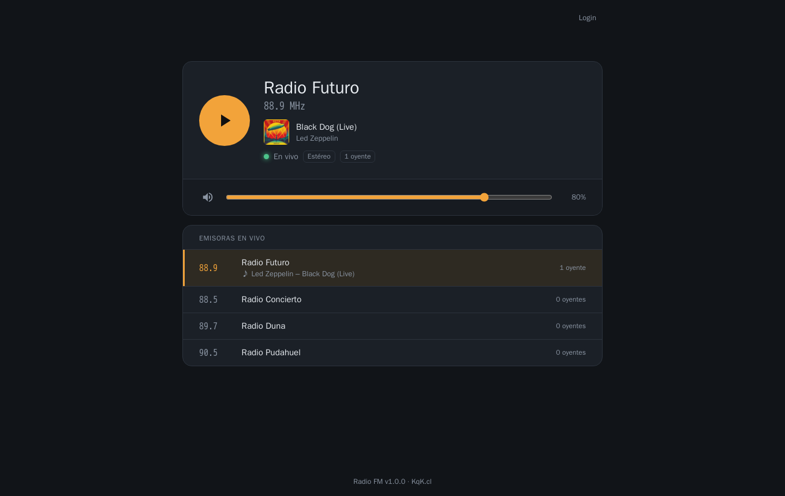
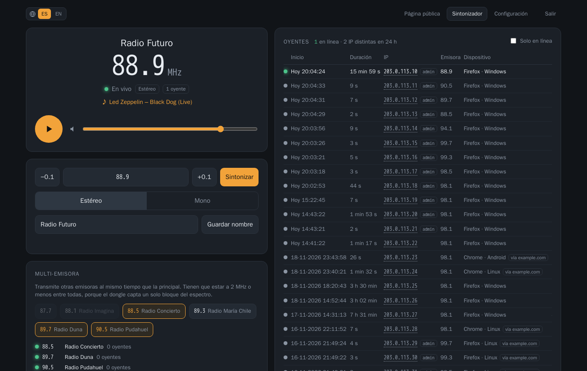
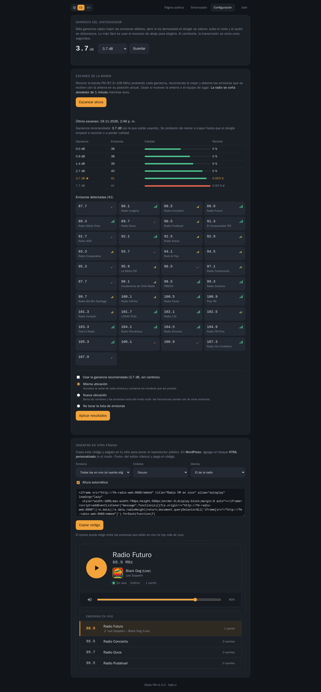
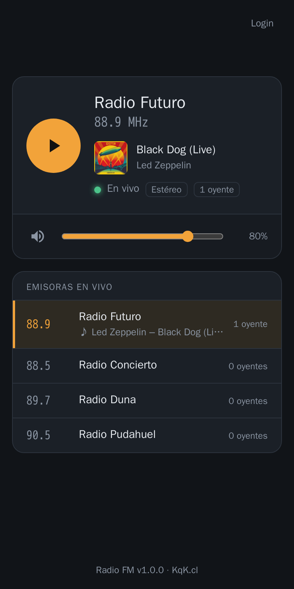

# Radio FM

[English](README.md) · **Español**

Versión 1.0.0 · [KqK.cl](https://kqk.cl)

Convierte un dongle **RTL-SDR** en una **radio FM por internet**: sintoniza emisoras de la banda FM,
las decodifica en estéreo y las transmite como MP3 a un reproductor web, con un panel de administración
para cambiar de emisora, transmitir varias a la vez y ver quién está escuchando.

- **Reproductor web público**: play/stop, volumen, nombre de la emisora y la **canción que suena** (con
  carátula), lista de emisoras en vivo para elegir. Funciona en celular, con controles en la pantalla de bloqueo.
- **Multi-emisora**: transmite **hasta 6 emisoras a la vez** con un solo dongle, si caben en el mismo
  bloque de 2 MHz del espectro.
- **Escaneo de la banda**: recorre 87,5–108 MHz, **elige la mejor ganancia** del dongle y detecta las
  emisoras que se reciben, con su calidad de señal. Útil al instalarlo o si mueves la antena.
- **Reconocimiento de canciones** de cada emisora que tenga oyentes (vía [ShazamIO](https://github.com/shazamio/ShazamIO)).
- **Registro de oyentes**: inicio, duración, IP, emisora, dispositivo y datos transferidos; quién está en línea ahora.
- **Insertar en otra página** (WordPress u otra): el admin genera el código del reproductor, con emisora
  fija o lista, colores oscuros o claros y altura automática.
- Interfaz en **español o inglés**. Login con límite de intentos y [Cloudflare Turnstile](https://www.cloudflare.com/products/turnstile/) opcional.
- Liviano: con 5 emisoras a la vez usa cerca de **un núcleo de CPU** (probado en un PC x86 normal).

---

## Capturas



<details>
<summary>Más capturas (sintonizador, configuración, celular)</summary>

<table>
<tr><td width="50%" align="center"><a href="docs/screenshots/es-tuner.png"></a><br><sub>Admin: sintonizador, multi-emisora y registro de oyentes</sub></td>
<td width="50%" align="center"><a href="docs/screenshots/es-settings.png"></a><br><sub>Configuración: ganancia, escaneo de la banda y código para insertar</sub></td></tr>
<tr><td width="50%" align="center"><a href="docs/screenshots/es-mobile.png"></a><br><sub>Reproductor en el celular</sub></td><td></td></tr>
</table>
</details>

<sub>Las IPs del registro de oyentes son ficticias.</sub>

---

## Contenido

1. [Requisitos](#1-requisitos)
2. [Instalación](#2-instalación)
3. [Primeros pasos](#3-primeros-pasos)
4. [Publicarlo en un dominio (proxy inverso)](#4-publicarlo-en-un-dominio-proxy-inverso)
5. [Insertar el reproductor en otra página](#5-insertar-el-reproductor-en-otra-página)
6. [Configuración (.env)](#6-configuración-env)
7. [Cómo funciona](#7-cómo-funciona)
8. [Mantenimiento](#8-mantenimiento)
9. [Problemas comunes](#9-problemas-comunes)
10. [Seguridad](#10-seguridad)
11. [Aviso legal](#11-aviso-legal)
12. [Créditos y software de terceros](#12-créditos-y-software-de-terceros)
13. [Licencia](#licencia)

---

## 1. Requisitos

- **Dongle RTL-SDR** con tuner R820T/R820T2 (probado con el **RTL-SDR Blog V3**) y una antena
  para FM (un dipolo de ~75 cm por brazo, o la antena telescópica que trae el kit, funciona bien).
- Un servidor **Linux** con **Docker** y **Docker Compose** (v2), con el dongle conectado por USB.
  Probado en Ubuntu 24.04 (x86-64).
- CPU: una fracción de un núcleo con una emisora; ~1 núcleo con 5 a la vez.
- Para el reconocimiento de canciones, salida a internet.

El host no necesita tener nada más instalado: el driver de usuario (`librtlsdr`) va dentro del contenedor.

## 2. Instalación

```bash
git clone https://github.com/r34lcl/Radio-FM.git
cd Radio-FM
cp .env.example .env
nano .env        # contraseñas, usuario del admin y frecuencia inicial
docker compose up -d --build
```

Para generar contraseñas y la clave de sesión: `openssl rand -hex 24`.

La primera construcción tarda unos minutos (compila airspy-fmradion). Luego abre:

- **Reproductor público:** `http://<servidor>:8080/`
- **Admin:** `http://<servidor>:8080/admin`

Revisa que todo partió bien con `docker compose logs -f tuner`: deberías ver que se abre el dongle y
que la emisora queda transmitiendo.

## 3. Primeros pasos

1. Entra al admin y ve a **Configuración → Escaneo de la banda → Escanear ahora**. Durante ~1 minuto la
   radio se detiene mientras se prueban las ganancias y se recorre la banda.
2. Revisa el resultado: ganancia recomendada y emisoras detectadas. Pulsa **Aplicar resultados**.
3. En **Sintonizador**, elige una emisora de la lista (las barras indican la calidad de señal) y ponle
   nombre con **Guardar nombre**. El nombre aparece en el reproductor público y en los metadatos del stream.
4. **Multi-emisora**: marca otras emisoras cercanas (a ≤ 2 MHz de la principal) para transmitirlas a la
   vez. El reproductor público mostrará la lista para que cada oyente elija.
5. Si una emisora tiene 1 barra de señal, prueba **Mono**: se escucha con mucho menos ruido.

El idioma de la web (también el de la página pública) se cambia con el selector **ES / EN** del admin.

## 4. Publicarlo en un dominio (proxy inverso)

Para usarlo desde internet con HTTPS, ponlo detrás de un proxy inverso (Nginx Proxy Manager, Caddy,
Traefik, nginx…) apuntando a `http://<servidor>:8080`, y en `.env`:

```env
COOKIE_SECURE=true   # la cookie de sesión solo viaja por HTTPS
TRUST_PROXY=true     # tomar la IP real del oyente desde X-Real-IP / X-Forwarded-For
```

Luego `docker compose up -d`. Con nginx, conviene desactivar el buffer en la ruta del audio (la web ya
envía `X-Accel-Buffering: no`, que nginx respeta):

```nginx
location / {
    proxy_pass http://127.0.0.1:8080;
    proxy_set_header Host $host;
    proxy_set_header X-Real-IP $remote_addr;
    proxy_buffering off;
    proxy_read_timeout 1d;
}
```

Con `TRUST_PROXY=true` **no** publiques el puerto 8080 directamente a internet: cualquiera podría
inventar su IP. En ese caso cambia el puerto en `docker-compose.yml` a `"127.0.0.1:8080:8080"`.

**Cloudflare:** el proxy de Cloudflare no está pensado para transmitir audio continuo (sus términos lo
limitan). Usa el dominio en modo "solo DNS" (nube gris) o un proxy propio.

## 5. Insertar el reproductor en otra página

En **Configuración → Insertar en otra página** eliges emisora (todas o una fija), colores, idioma y si la
altura se ajusta sola; luego **Copiar código** y pégalo en tu sitio. En WordPress: un bloque
**HTML personalizado**. Solo la ruta `/embed` se puede mostrar dentro de otras páginas.

Para que lo vean visitantes de afuera, la radio tiene que ser accesible desde internet (sección 4).
Quien escucha desde una página insertada aparece en el registro de oyentes con la etiqueta «vía sitio».

## 6. Configuración (.env)

| Variable | Por defecto | Descripción |
|---|---|---|
| `FREQ` | — | Frecuencia inicial en MHz. Después manda lo que se elija en la web. |
| `GAIN` | `auto` | Ganancia del dongle en dB. Mejor elegirla con el escaneo. |
| `STEREO` | `1` | `1` estéreo, `0` mono. |
| `BITRATE` | `192k` | Bitrate del MP3. |
| `DEVICE_INDEX` | `0` | Qué dongle usar si hay varios. |
| `ICECAST_SOURCE_PASSWORD` / `ICECAST_ADMIN_PASSWORD` | — | Contraseñas internas de Icecast. |
| `ICECAST_MAX_CLIENTS` | `20` | Máximo de oyentes simultáneos. |
| `ICECAST_PORT` | `8010` | Puerto de Icecast, solo en `127.0.0.1`. |
| `WEB_PORT` | `8080` | Puerto de la web. |
| `WEB_USER` / `WEB_PASSWORD` | — | Usuario y contraseña del admin. |
| `SESSION_SECRET` | — | Clave para firmar las sesiones. |
| `COOKIE_SECURE` | `false` | `true` si se sirve por HTTPS. |
| `TRUST_PROXY` | `false` | `true` detrás de un proxy inverso. |
| `LISTENER_LOG_DAYS` | `90` | Días que se guarda el registro de oyentes. |
| `TURNSTILE_SITE_KEY` / `TURNSTILE_SECRET_KEY` | vacío | Captcha de Cloudflare en el login (opcional). |
| `SONGID_INTERVAL` | `45` | Segundos entre identificaciones de canción por emisora. |

Lo que se cambia desde la web (emisora, emisoras extra, mono/estéreo, ganancia, nombres, idioma) se guarda
en la carpeta `state/` y tiene prioridad sobre `.env`.

## 7. Cómo funciona

```
                         ┌──────────────── contenedor "tuner" ────────────────┐
 antena ─► RTL-SDR ─USB─►│ una emisora:  airspy-fmradion ─► ffmpeg (MP3) ──────┼─► Icecast ─► web ─► oyentes
                         │ varias:  rtl_sdr ─► channelizer.py ─► airspy-fmradion│      │
                         │                    (1 FFT, N canales)   × N ─► ffmpeg │      └─► songid (Shazam)
                         └─────────────────────────────────────────────────────┘
```

- **tuner**: `tuner.sh` lee la sintonía elegida en la web (`state/plan`) y lanza el pipeline. Con una
  emisora, [airspy-fmradion](https://github.com/jj1bdx/airspy-fmradion) lee directo del dongle. Con varias,
  `rtl_sdr` captura un bloque de 2,304 MHz y `channelizer.py` (NumPy, convolución rápida overlap-save) separa
  cada emisora en su propio canal de 384 kHz, que decodifica una instancia de airspy-fmradion. Cada emisora
  se codifica con ffmpeg y se publica en Icecast como `/fm<frecuencia>.mp3` (p. ej. `/fm981.mp3`).
  También ejecuta el escaneo de la banda (`scan.py`).
- **icecast**: servidor de streaming interno.
- **web**: `web/app.py` (solo biblioteca estándar de Python). Sirve el reproductor y el admin, y retransmite
  el audio de Icecast a los oyentes, lo que permite llevar el registro de conexiones.
- **songid**: cada cierto tiempo toma unos segundos del audio de cada emisora con oyentes y los identifica
  con ShazamIO. Es opcional: si no lo quieres, no lo levantes (`docker compose up -d icecast tuner web`).

## 8. Mantenimiento

- **Actualizar:** `git pull && docker compose up -d --build`.
- **Respaldo:** la carpeta `state/` (emisoras y nombres, sintonía, registro de oyentes) y el `.env`.
- **Logs:** `docker compose logs -f tuner` (radio), `web`, `songid`.
- **Cambié la antena o el equipo de lugar:** nuevo escaneo en Configuración. "Misma ubicación" conserva los
  nombres; "Nueva ubicación" los borra (las frecuencias pueden ser de otras emisoras).

## 9. Problemas comunes

| Síntoma | Qué hacer |
|---|---|
| `usb_claim_interface error -6` | Otro programa usa el dongle, o el kernel cargó el driver de TV. En el host: `echo 'blacklist dvb_usb_rtl28xxu' \| sudo tee /etc/modprobe.d/rtlsdr.conf`, desconecta y conecta el dongle. |
| `No supported devices found` | Revisa `lsusb` (debe aparecer `Realtek RTL2838`) y que el contenedor vea `/dev/bus/usb`. |
| Audio con mucho ruido o soplido | Señal débil: prueba Mono, mejora la ubicación de la antena o haz el escaneo para ajustar la ganancia. |
| Audio distorsionado | Ganancia demasiado alta (el dongle se satura). Haz el escaneo o baja la ganancia. |
| Una emisora extra no se puede marcar | No cabe en el mismo bloque de 2 MHz con las demás, o ya hay 6. |
| El reproductor insertado no carga fuera de casa | La radio no es accesible desde internet (ver sección 4). |
| No reconoce canciones | Requiere internet; habla, publicidad y música poco conocida no siempre se identifican. |

## 10. Seguridad

- Usa contraseñas largas en `.env` y no lo subas a ningún repositorio (está en `.gitignore`).
- El login tiene límite de intentos por IP; con `TRUST_PROXY=true` la IP sale del proxy, así que la web
  no debe quedar expuesta sin pasar por él.
- El admin envía `X-Frame-Options: DENY`; solo `/embed` se puede insertar en otros sitios.
- El registro de oyentes guarda IPs: si lo usas de forma pública, considera la normativa de datos personales
  de tu país y ajusta `LISTENER_LOG_DAYS`.

## 11. Aviso legal

- **Retransmitir emisoras** por internet puede requerir permiso de las emisoras o de las entidades de
  derechos de autor de tu país. Este proyecto está pensado para uso personal o con autorización; la
  responsabilidad por su uso es de quien lo instala.
- **ShazamIO** usa una API no oficial de Shazam. Este proyecto no está afiliado a Shazam ni a Apple, y ese
  servicio puede dejar de funcionar en cualquier momento.
- Las carátulas y metadatos de las canciones pertenecen a sus dueños.

## 12. Créditos y software de terceros

Radio FM se apoya en estos proyectos (gracias a sus autores). Este repositorio no incluye su código: las
imágenes Docker los descargan e instalan al construirse, cada uno con su propia licencia.

| Proyecto | Uso | Licencia |
|---|---|---|
| [airspy-fmradion](https://github.com/jj1bdx/airspy-fmradion) (Kenji Rikitake, JJ1BDX; basado en SoftFM de Joris van Rantwijk y NGSoftFM de Edouard Griffiths, F4EXB) | Decodificación FM estéreo | GPL-3.0 |
| [rtl-sdr / librtlsdr](https://osmocom.org/projects/rtl-sdr) (Osmocom) | Acceso al dongle | GPL-2.0 |
| [Icecast](https://icecast.org) (Xiph.Org) | Servidor de streaming | GPL-2.0 |
| [FFmpeg](https://ffmpeg.org) | Codificación MP3 (LAME) | LGPL/GPL |
| [NumPy](https://numpy.org) | Separación de canales y escaneo | BSD-3-Clause |
| [ShazamIO](https://github.com/shazamio/ShazamIO) | Reconocimiento de canciones | MIT |

Si distribuyes una **imagen Docker ya construida**, también distribuyes esos programas y debes cumplir sus
licencias (en particular, ofrecer el código fuente de los componentes GPL).

## Licencia

Radio FM se distribuye bajo la [Licencia Apache 2.0](LICENSE). Puedes usarlo, modificarlo y redistribuirlo;
toda copia o trabajo derivado debe conservar el archivo [NOTICE](NOTICE), indicando que se basa en
Radio FM de [KqK.cl](https://kqk.cl).
