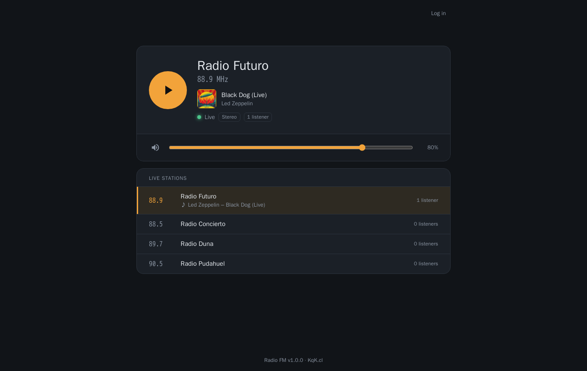
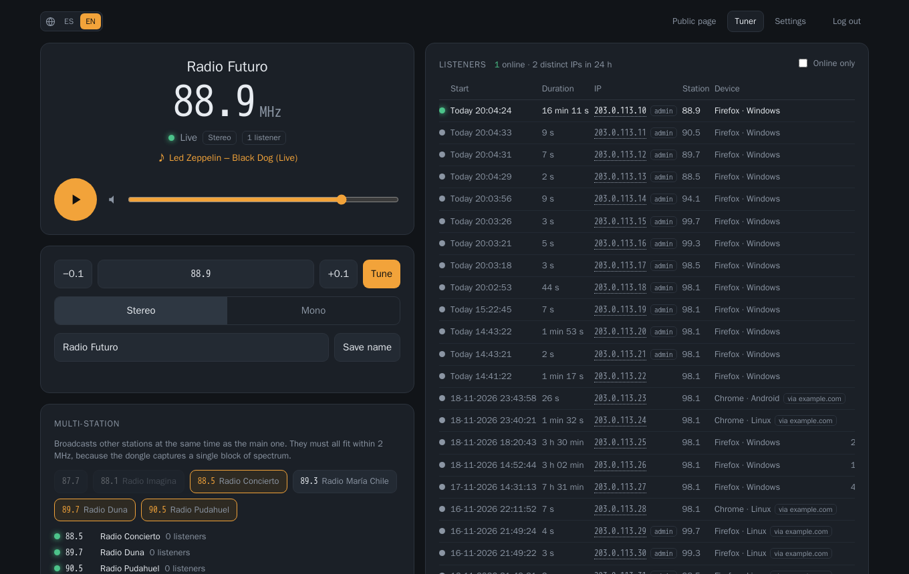
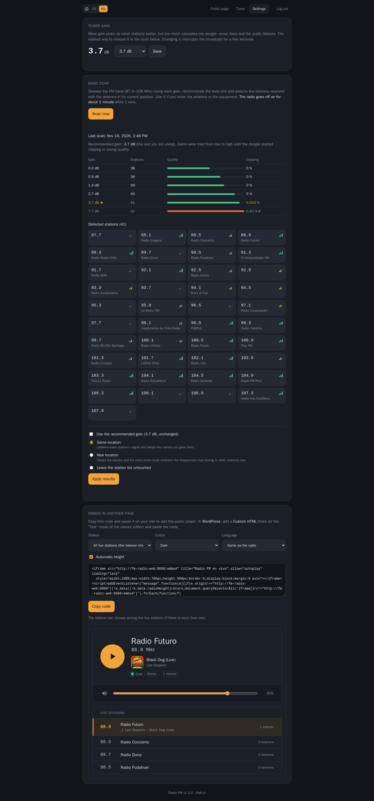
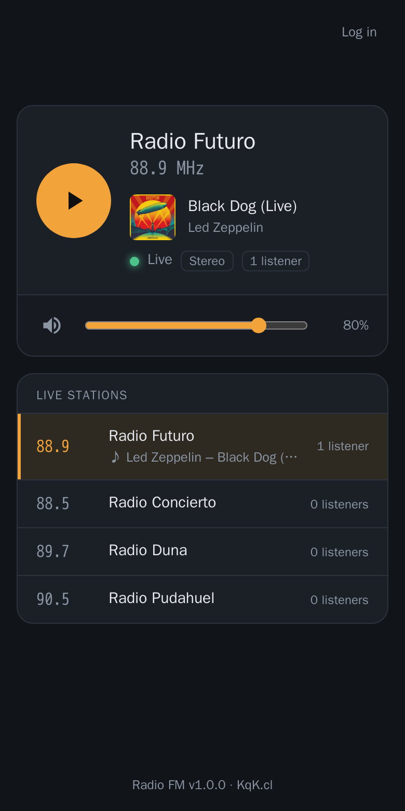

# Radio FM

**English** · [Español](README.es.md)

Version 1.0.0 · [KqK.cl](https://kqk.cl)

Turns an **RTL-SDR** dongle into an **internet FM radio**: it tunes stations on the FM band, decodes them
in stereo and streams them as MP3 to a web player, with an admin panel to change stations, broadcast
several at once and see who is listening.

- **Public web player**: play/stop, volume, station name and the **song that is playing** (with cover
  art), and a list of live stations to choose from. Works on phones, with lock-screen controls.
- **Multi-station**: broadcasts **up to 6 stations at once** with a single dongle, as long as they fit in
  the same 2 MHz block of spectrum.
- **Band scan**: sweeps 87.5–108 MHz, **picks the best gain** for the dongle and detects the stations you
  can receive, with their signal quality. Useful at install time or after moving the antenna.
- **Song recognition** for every station that has listeners (via [ShazamIO](https://github.com/shazamio/ShazamIO)).
- **Listener log**: start time, duration, IP, station, device and data transferred; who is online right now.
- **Embed in another page** (WordPress or any site): the admin generates the player code, with a fixed
  station or a list, dark or light colors and automatic height.
- Interface in **English or Spanish**. Login with attempt limiting and optional [Cloudflare Turnstile](https://www.cloudflare.com/products/turnstile/).
- Lightweight: 5 stations at once use about **one CPU core** (tested on an ordinary x86 PC).

---

## Screenshots



<details>
<summary>More screenshots (tuner, settings, phone)</summary>

<table>
<tr><td width="50%" align="center"><a href="docs/screenshots/en-tuner.png"></a><br><sub>Admin: tuner, multi-station and listener log</sub></td>
<td width="50%" align="center"><a href="docs/screenshots/en-settings.png"></a><br><sub>Settings: gain, band scan and embed code</sub></td></tr>
<tr><td width="50%" align="center"><a href="docs/screenshots/en-mobile.png"></a><br><sub>Player on a phone</sub></td><td></td></tr>
</table>
</details>

<sub>IP addresses in the listener log are fictitious.</sub>

---

## Contents

1. [Requirements](#1-requirements)
2. [Installation](#2-installation)
3. [First steps](#3-first-steps)
4. [Publishing it on a domain (reverse proxy)](#4-publishing-it-on-a-domain-reverse-proxy)
5. [Embedding the player in another page](#5-embedding-the-player-in-another-page)
6. [Configuration (.env)](#6-configuration-env)
7. [How it works](#7-how-it-works)
8. [Maintenance](#8-maintenance)
9. [Troubleshooting](#9-troubleshooting)
10. [Security](#10-security)
11. [Legal notice](#11-legal-notice)
12. [Credits and third-party software](#12-credits-and-third-party-software)
13. [License](#license)

---

## 1. Requirements

- An **RTL-SDR dongle** with an R820T/R820T2 tuner (tested with the **RTL-SDR Blog V3**) and an FM antenna
  (a dipole with ~75 cm arms, or the telescopic antenna that comes with the kit, works well).
- A **Linux** server with **Docker** and **Docker Compose** (v2), with the dongle plugged in over USB.
  Tested on Ubuntu 24.04 (x86-64).
- CPU: a fraction of a core for one station; ~1 core for 5 at once.
- Internet access for song recognition.

Nothing else has to be installed on the host: the user-space driver (`librtlsdr`) lives inside the container.

## 2. Installation

```bash
git clone https://github.com/r34lcl/Radio-FM.git
cd Radio-FM
cp .env.example .env
nano .env        # passwords, admin user and initial frequency
docker compose up -d --build
```

To generate passwords and the session key: `openssl rand -hex 24`.

The first build takes a few minutes (it compiles airspy-fmradion). Then open:

- **Public player:** `http://<server>:8080/`
- **Admin:** `http://<server>:8080/admin`

Check that everything started with `docker compose logs -f tuner`: you should see the dongle being opened
and the station going on air.

## 3. First steps

1. Log in to the admin and go to **Settings → Band scan → Scan now**. The radio stops for about a minute
   while gains are tried and the band is swept.
2. Review the result: recommended gain and detected stations. Press **Apply results**.
3. In **Tuner**, pick a station from the list (the bars show signal quality) and name it with
   **Save name**. The name shows up in the public player and in the stream metadata.
4. **Multi-station**: select other nearby stations (within 2 MHz of the main one) to broadcast them at the
   same time. The public player then shows the list so each listener can choose.
5. If a station has 1 signal bar, try **Mono**: it sounds much less noisy.

The web language (including the public page) is changed with the **ES / EN** selector in the admin.

## 4. Publishing it on a domain (reverse proxy)

To use it from the internet over HTTPS, put it behind a reverse proxy (Nginx Proxy Manager, Caddy,
Traefik, nginx…) pointing to `http://<server>:8080`, and set in `.env`:

```env
COOKIE_SECURE=true   # the session cookie only travels over HTTPS
TRUST_PROXY=true     # take the listener's real IP from X-Real-IP / X-Forwarded-For
```

Then `docker compose up -d`. With nginx, disable buffering for the audio (the web already sends
`X-Accel-Buffering: no`, which nginx honors):

```nginx
location / {
    proxy_pass http://127.0.0.1:8080;
    proxy_set_header Host $host;
    proxy_set_header X-Real-IP $remote_addr;
    proxy_buffering off;
    proxy_read_timeout 1d;
}
```

With `TRUST_PROXY=true`, do **not** expose port 8080 directly to the internet: anyone could fake their IP.
In that case change the port in `docker-compose.yml` to `"127.0.0.1:8080:8080"`.

**Cloudflare:** Cloudflare's proxy is not meant for continuous audio streaming (their terms limit it).
Use the domain in "DNS only" mode (grey cloud) or your own proxy.

## 5. Embedding the player in another page

In **Settings → Embed in another page** choose the station (all or a fixed one), colors, language and
whether the height adjusts automatically; then **Copy code** and paste it on your site. In WordPress: a
**Custom HTML** block. Only the `/embed` path can be shown inside other pages.

For outside visitors to see it, the radio must be reachable from the internet (section 4). Listeners who
come from an embedded player appear in the listener log tagged "via site".

## 6. Configuration (.env)

| Variable | Default | Description |
|---|---|---|
| `FREQ` | — | Initial frequency in MHz. Afterwards, what is chosen in the web wins. |
| `GAIN` | `auto` | Dongle gain in dB. Best chosen with the band scan. |
| `STEREO` | `1` | `1` stereo, `0` mono. |
| `BITRATE` | `192k` | MP3 bitrate. |
| `DEVICE_INDEX` | `0` | Which dongle to use if there are several. |
| `ICECAST_SOURCE_PASSWORD` / `ICECAST_ADMIN_PASSWORD` | — | Internal Icecast passwords. |
| `ICECAST_MAX_CLIENTS` | `20` | Maximum simultaneous listeners. |
| `ICECAST_PORT` | `8010` | Icecast port, on `127.0.0.1` only. |
| `WEB_PORT` | `8080` | Web port. |
| `WEB_USER` / `WEB_PASSWORD` | — | Admin username and password. |
| `SESSION_SECRET` | — | Key used to sign sessions. |
| `COOKIE_SECURE` | `false` | `true` when served over HTTPS. |
| `TRUST_PROXY` | `false` | `true` behind a reverse proxy. |
| `LISTENER_LOG_DAYS` | `90` | Days the listener log is kept. |
| `TURNSTILE_SITE_KEY` / `TURNSTILE_SECRET_KEY` | empty | Cloudflare captcha on the login page (optional). |
| `SONGID_INTERVAL` | `45` | Seconds between song identifications per station. |

Whatever is changed from the web (station, extra stations, mono/stereo, gain, names, language) is stored
in the `state/` folder and takes precedence over `.env`.

## 7. How it works

```
                         ┌───────────────── "tuner" container ─────────────────┐
 antenna ─► RTL-SDR ─USB─►│ one station: airspy-fmradion ─► ffmpeg (MP3) ───────┼─► Icecast ─► web ─► listeners
                         │ several: rtl_sdr ─► channelizer.py ─► airspy-fmradion │      │
                         │                    (1 FFT, N channels)  × N ─► ffmpeg │      └─► songid (Shazam)
                         └──────────────────────────────────────────────────────┘
```

- **tuner**: `tuner.sh` reads the tuning chosen in the web (`state/plan`) and starts the pipeline. With one
  station, [airspy-fmradion](https://github.com/jj1bdx/airspy-fmradion) reads straight from the dongle. With
  several, `rtl_sdr` captures a 2.304 MHz block and `channelizer.py` (NumPy, overlap-save fast convolution)
  splits each station into its own 384 kHz channel, decoded by one airspy-fmradion instance each. Every
  station is encoded with ffmpeg and published on Icecast as `/fm<frequency>.mp3` (e.g. `/fm981.mp3`). It
  also runs the band scan (`scan.py`).
- **icecast**: internal streaming server.
- **web**: `web/app.py` (Python standard library only). Serves the player and the admin, and relays the
  audio from Icecast to listeners, which is what makes the listener log possible.
- **songid**: every so often it takes a few seconds of audio from each station with listeners and
  identifies it with ShazamIO. It is optional: if you don't want it, don't start it
  (`docker compose up -d icecast tuner web`).

## 8. Maintenance

- **Update:** `git pull && docker compose up -d --build`.
- **Backup:** the `state/` folder (stations and names, tuning, listener log) and `.env`.
- **Logs:** `docker compose logs -f tuner` (radio), `web`, `songid`.
- **Moved the antenna or the equipment:** run a new scan in Settings. "Same location" keeps the names;
  "New location" clears them (the frequencies may belong to other stations now).

## 9. Troubleshooting

| Symptom | What to do |
|---|---|
| `usb_claim_interface error -6` | Another program is using the dongle, or the kernel loaded the DVB-T driver. On the host: `echo 'blacklist dvb_usb_rtl28xxu' \| sudo tee /etc/modprobe.d/rtlsdr.conf`, then unplug and replug the dongle. |
| `No supported devices found` | Check `lsusb` (it should list `Realtek RTL2838`) and that the container sees `/dev/bus/usb`. |
| Noisy or hissing audio | Weak signal: try Mono, improve the antenna position, or run the scan to adjust the gain. |
| Distorted audio | Gain too high (the dongle saturates). Run the scan or lower the gain. |
| An extra station can't be selected | It doesn't fit in the same 2 MHz block with the others, or there are already 6. |
| The embedded player doesn't load outside your network | The radio isn't reachable from the internet (see section 4). |
| Songs aren't recognized | Needs internet; talk, ads and obscure music aren't always identified. |

## 10. Security

- Use long passwords in `.env` and never commit it to any repository (it is in `.gitignore`).
- The login limits attempts per IP; with `TRUST_PROXY=true` the IP comes from the proxy, so the web must
  not be reachable without going through it.
- The admin sends `X-Frame-Options: DENY`; only `/embed` can be embedded in other sites.
- The listener log stores IP addresses: if you run it publicly, consider your country's personal data
  regulations and adjust `LISTENER_LOG_DAYS`.

## 11. Legal notice

- **Rebroadcasting stations** over the internet may require permission from the stations or from the
  copyright collecting societies of your country. This project is meant for personal use or use with
  permission; whoever installs it is responsible for how it is used.
- **ShazamIO** uses an unofficial Shazam API. This project is not affiliated with Shazam or Apple, and that
  service may stop working at any time.
- Song cover art and metadata belong to their owners.

## 12. Credits and third-party software

Radio FM builds on these projects (thanks to their authors). This repository does not include their code:
the Docker images download and install them at build time, each under its own license.

| Project | Used for | License |
|---|---|---|
| [airspy-fmradion](https://github.com/jj1bdx/airspy-fmradion) (Kenji Rikitake, JJ1BDX; based on SoftFM by Joris van Rantwijk and NGSoftFM by Edouard Griffiths, F4EXB) | Stereo FM decoding | GPL-3.0 |
| [rtl-sdr / librtlsdr](https://osmocom.org/projects/rtl-sdr) (Osmocom) | Dongle access | GPL-2.0 |
| [Icecast](https://icecast.org) (Xiph.Org) | Streaming server | GPL-2.0 |
| [FFmpeg](https://ffmpeg.org) | MP3 encoding (LAME) | LGPL/GPL |
| [NumPy](https://numpy.org) | Channel splitting and band scan | BSD-3-Clause |
| [ShazamIO](https://github.com/shazamio/ShazamIO) | Song recognition | MIT |

If you distribute an **already built Docker image**, you also distribute those programs and must comply
with their licenses (in particular, offering the source code of the GPL components).

## License

Radio FM is distributed under the [Apache License 2.0](LICENSE). You may use, modify and redistribute it;
every copy or derivative work must keep the [NOTICE](NOTICE) file, stating that it is based on Radio FM by
[KqK.cl](https://kqk.cl).
